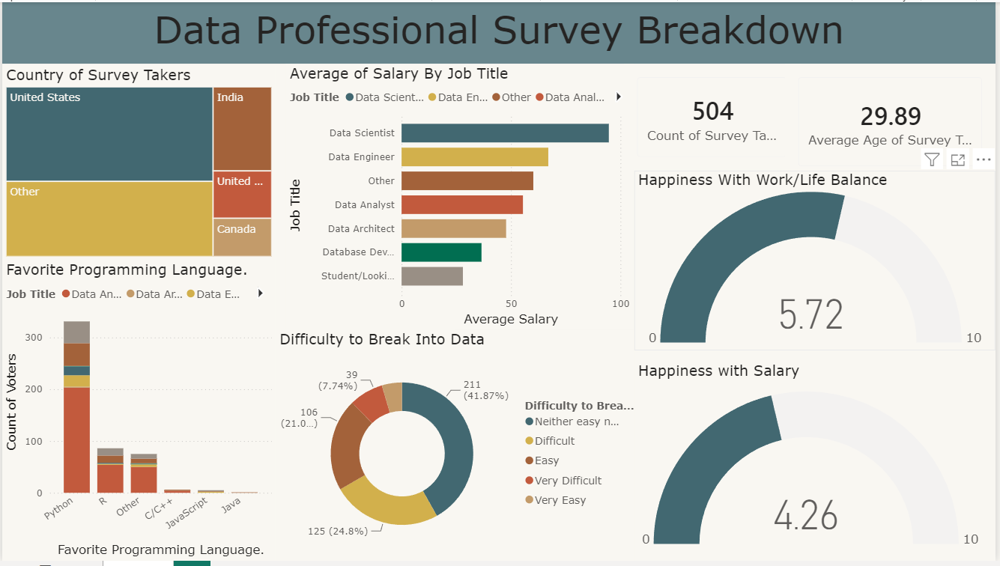

# 📊 Data Professional Survey Breakdown (Power BI Dashboard)
A comprehensive interactive Power BI dashboard built to analyze global survey responses from data professionals, uncovering key insights regarding salaries, preferred programming languages, job satisfaction, demographics, and career transition trends.

---

## 🖼️ Dashboard Preview


---

## 📌 Project Overview & Objective
```text
-This project analyzes survey data collected from data professionals across various roles and geographies. The primary goal is to provide data-driven insights into:
-Global distribution and demographics of data survey respondents.
-Average salary breakdowns across different data job titles (Data Scientist, Data Engineer, Data Analyst, etc.).
-Popularity of programming languages used by professionals.
-Career transition difficulties and satisfaction levels regarding salary and work-life balance.
```

---

## 📂 Dataset Structure & Schema
The dataset contains raw survey responses capturing professional demographics, technical stacks, and workplace satisfaction metrics.

## Key Columns / Attributes:
- **Demographics & Background**: Country of Survey Takers, Current Age, Highest Level of Education, Gender.
- **Employment Details**: Job Title (Q1), Industry (Q4), Career Transition status (Q2), Current Yearly Salary in USD (Q3).
- **Technical Skills**: Favorite Programming Language (Q5).
- **Satisfaction & Challenges**: Happiness with Salary & Happiness with Work/Life Balance (Q6 ratings out of 10).
-Difficulty to Break Into Data (Q7).

## 📈 Dashboard Layout & Key Visualizations
The single-page interactive dashboard is structured with the following core visual components:
- **Top KPI Cards**: Total Survey Takers: 504 respondents.
- **Average Age**: 29.89 years.
- **Country Breakdown (Treemap)**: Displays survey participation distribution globally, highlighting major representation from the United States, India, United Kingdom, and Canada.
- **Average Salary by Job Title (Bar Chart)**: Horizontal bar chart comparing average annual salaries across roles such as Data Scientist, Data Engineer, Data Analyst, Data Architect, and Database Developer.
- **Favorite Programming Language (Stacked Bar Chart)**: Evaluates programming language adoption (Python, R, C/C++, JavaScript, Java, etc.) filtered or segmented by job roles.
- **Difficulty to Break Into Data (Donut Chart)**: Visualizes survey sentiment regarding entry barriers into the data industry (categories including Easy, Very Easy, Difficult, Very Difficult, and Neither easy nor difficult).
- **Workplace Happiness (Gauge / Semi-Circle Meters)**: Work/Life Balance Happiness Score: Average rating of 5.72 / 10.
- **Salary Satisfaction Score**: Average rating of 4.26 / 10.

---

## 💡 Key Insights & Findings
- **Salary Leadership**: Data Scientists and Data Engineers command the highest average compensation among survey respondents.
- **Language Dominance**: Python is overwhelmingly the most popular programming language across almost all data roles, followed by R and other utility tools.
- **Career Entry Sentiment**: A significant portion of respondents find breaking into the data industry moderately to very challenging, highlighting a high demand for structured onboarding and skill-building.
- **Satisfaction Trends**: Work-life balance ratings (5.72) lean moderately positive, whereas salary satisfaction ratings (4.26) indicate room for financial growth and higher expectations among professionals.

---

## 🛠️ Tools & Technologies Used
- **Data Visualization & BI**: Power BI Desktop
- **Data Processing**: Power Query (Transformations, Column splitting, Data type casting)
- **Data Source**: CSV / Excel Survey Dataset

---

## 💻 How to View / Run Locally
```text
-Clone or download this repository.
-Ensure you have Power BI Desktop installed on your system.
-Open the .pbix file located inside the repository to explore the fully interactive data model and visuals.
```

---
